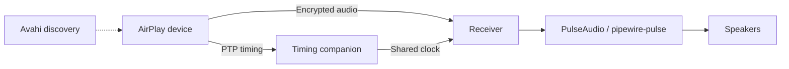

# Shairport Sync

[](https://github.com/gstn-caruso/shairport-2/actions/workflows/receiver.yml)
[](https://github.com/gstn-caruso/shairport-2/releases)
[](LICENSES)
[](BUILD.md)

An open-source AirPlay 2 audio receiver for Linux. Select this receiver on an
AirPlay device to play through the Linux machine's speakers.

This fork supports realtime and buffered playback, encrypted pairing,
sender-controlled volume, and ALAC/AAC stereo and surround streams. It uses
PulseAudio or PipeWire's `pipewire-pulse` server, Avahi for discovery, and a
bundled timing companion. AirPlay 1 and other audio backends are unsupported.

## How it works

The receiver discovers and pairs with senders, decrypts and decodes incoming
audio with FFmpeg, then schedules PCM playback through PulseAudio. The timing
companion tracks the sender's PTP clock and shares clock information with the
receiver. Both applications are built and packaged together.



The receiver runs as a systemd **user service** in the audio user's session.
The timing companion and Avahi run as system services.

## Build and install

Requirements: Linux, CMake 4.2+, Ninja, pinned Clang 23.1.3, libstdc++ 15 and
the native development libraries listed in [BUILD.md](BUILD.md). Tests require
GoogleTest 1.17+. Install those dependencies first, then run:

```sh
cmake -S . -B build/cmake -G Ninja \
  -DCMAKE_TOOLCHAIN_FILE=cmake/clang-toolchain.cmake \
  -DCMAKE_BUILD_TYPE=Release -DCMAKE_INSTALL_SYSCONFDIR=/etc
cmake --build build/cmake --parallel 2
ctest --test-dir build/cmake --output-on-failure
DESTDIR="$PWD/build/cmake/stage" cmake --install build/cmake
```

Inspect the staged files before installing on the host:

```sh
sudo cmake --install build/cmake
sudo cp --no-clobber /etc/shairport-sync.conf.sample /etc/shairport-sync.conf
```

[BUILD.md](BUILD.md) covers dependencies, Debian packages and upgrades from a
standalone timing companion. Stop an older timing service before activating
the bundled one; they use the same ports and shared memory.

## Configure and play

Edit `/etc/shairport-sync.conf` using the
[sample configuration](scripts/shairport-sync.conf). Set `general.name` for the
advertised name and optionally `pulseaudio.sink` for the audio destination.
Make sure Avahi and the user's PulseAudio-compatible session are running.

```sh
sudo systemctl daemon-reload
sudo systemctl enable --now shairport-sync-nqptp
systemctl --user daemon-reload
systemctl --user enable --now shairport-sync
```

Select the receiver in your device's AirPlay output picker and start playback.
After changing configuration or restarting the timing companion, restart the
receiver with `systemctl --user restart shairport-sync`.

If startup or playback fails, use `journalctl --user -u shairport-sync` and
`sudo journalctl -u shairport-sync-nqptp`. Follow
[configuration and troubleshooting](CONFIGURATION.md) for audio, discovery,
Home pairing and migration checks.

## Read further and contribute

- [BUILD.md](BUILD.md): dependencies, build, tests, installation and packaging.
- [CONFIGURATION.md](CONFIGURATION.md): supported options, upgrades and troubleshooting.
- [Architecture](docs/architecture.md): source responsibilities, protocol boundaries and known limitations.

Production code lives in `src/`, tests in `tests/`, the timing companion in
`companion/nqptp/`, and the bundled C pairing library in `pair_ap/`. Start with
the architecture guide when changing code, run the relevant tests, and open a
pull request. Report bugs with receiver/sender versions, stream format and logs.
Repository documentation, code and contributions use English.

The component migration is incomplete. Automated tests do not establish real
device, Home or multiroom acceptance; see the architecture guide's validation
limits. Release history is generated in [CHANGELOG.md](CHANGELOG.md); earlier
implementation records remain in Git history.

Licensing and attribution are in [LICENSES](LICENSES), [COPYING](COPYING), source
notices and the [timing companion provenance](companion/nqptp/PROVENANCE.md).
