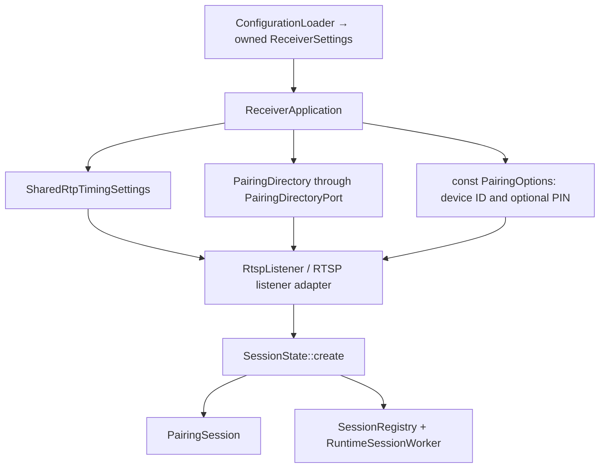

# Receiver architecture

This describes the delivered source at **v6.1.16** (PR71, source commit
`1a06ea54942ba9b9592269128f1ae68650d2082b`). The component migration is incomplete.
See [migration status](receiver-migration-progress.md) for remaining work and
[validation](../VALIDATION.md) for what the tests establish.

## Application and session dependencies

`ConfigurationLoader` returns owned `ReceiverSettings`. `ReceiverApplication`
keeps the runtime compatibility lease and creates three process/session inputs:
shared RTP timing settings, a pairing directory, and immutable pairing options.
The RTSP listener passes these exact owners to `SessionState::create`; missing
owners are rejected. Session construction remains defaulted/value-initialized.

The directory is shared by sessions from one application. Other application
instances have separate directories. `SharedRtpTimingSettings` owns the mutable
offset used by control reception and clock conversion. `PairingOptions` stays
immutable while native pairing contexts borrow its strings. Other runtime
consumers still read the global compatibility view; this is not complete
configuration or SessionState encapsulation.

## Component responsibilities

Each component has its own CMake target. Native libraries are explicit target
dependencies; isolated tests do not link the whole receiver unless they exercise
the runtime adapter. Source directories also contain transitional runtime code.

| Component | Decisions and state it owns | Boundary dependencies |
| --- | --- | --- |
| Configuration loader / startup options | Paths, argument statuses, validated owned settings | libconfig, environment inputs; no running services |
| `SessionRegistry` | Worker admission, retirement, retained ownership and joining | `ManagedSession`, Threads; runtime worker adapter separately |
| Principal selection | Current participant, replacement and selection tickets | `PrincipalParticipant`; runtime effects outside the module |
| RTSP message / request reader | Owned messages, framing, incremental input and terminal results | Explicit input port; native socket/cipher adapter outside |
| RTSP parameters | Parameter responses, wire volume and metadata interpretation | `ParameterVolumePort`; player/output effects outside |
| Buffered flush/block/playback/coordinator | Flush boundaries, authenticated block bytes and playback decisions | Explicit session/clock/player collaborators; Sodium at block boundary |
| Realtime audio ingress / control coordinator | Packet decoding/admission, anchors and checked latency arithmetic | Explicit ingress/control ports; native reception outside |
| Resend coordinator | Request ordering, suppression and backoff | Owned peer snapshots and datagram channel adapter |
| Byte queue / buffered TCP transport | Bounded byte ownership and terminal IO delivery | Threads, Linux socket/wakeup adapter |
| `ControlDatagramChannel` | Descriptor leases, IO wakeup and close-after-retirement | Remote peer component, Linux native IO |
| Event command exchange / event worker | Serialized commands, owned replies, listener/worker lifetime | Plaintext channel factory, callback and interrupt handle |
| `EncryptedChannel` | Cipher context, private ciphertext/plaintext buffers and response activation | `EncryptedByteIo`, `CipherDiagnostics`, native pairing library |
| Pairing directory / management | Ordered public-key records, owned snapshots and management responses | Standard-library directory port; pair_ap callback bridge separately |
| `PairingSession` | Setup/verify contexts, private result lifetime and channel preparation | Immutable options, encrypted channels, native pairing library |
| Decoder / resampler / output setup | Codec/frame state, conversion and negotiated output setup | Explicit FFmpeg libraries and backend port |
| PCM / output queue | Sample representation, gain/encoding and bounded FIFO occupancy | Native allocation where required; PulseAudio adapter outside queue |
| Playback timing / RTP clock / volume | Scheduling, clock mapping and volume policy | Typed values and explicit runtime effect adapters |
| Activity monitor | Transitions, deadlines, worker and admitted effects | Activity state and hook/output adapters |
| Bundled timing companion | PTP tracking, sockets, shared memory and signal-driven lifecycle | Linux/POSIX; independent system service |

PulseAudio, Avahi, NQPTP shared-memory access, subprocesses, runtime logging and
many RTSP/player effects remain native adapters or transitional receiver code.
The component map is not a claim that these remaining responsibilities are
fully isolated.

## Language modules

The concrete directory is exported from a module; ordinary-header
`PairingDirectoryPort` values connect it to native/session code without a
conflicting global forward declaration. Module scanning is enabled on module
targets and importing translation units, rather than every source by default.

| Module | Responsibility |
| --- | --- |
| `receiver.session.principal` | Principal selection policy |
| `receiver.protocol.rtsp.request` | Incremental RTSP framing |
| `receiver.protocol.rtsp.parameters` | RTSP parameter interpretation |
| `receiver.protocol.ap2.buffered_block` | Buffered block metadata and authenticated payload preparation |
| `receiver.protocol.ap2.buffered_playback` | Buffered playback policy |
| `receiver.protocol.ap2.buffered_coordinator` | Buffered reception coordination |
| `receiver.protocol.ap2.realtime_audio` | Realtime ingress |
| `receiver.protocol.ap2.control_packet` | Control packet interpretation and coordination |
| `receiver.protocol.ap2.pairing_directory` | Concrete synchronized pairing records |
| `receiver.audio.output.queue` | Bounded PCM FIFO |

Ordinary headers remain appropriate for native IO/resource owners and types
embedded in SessionState. Pairing C APIs and the opaque C message adapters keep
their genuine C boundaries. The project is not yet CXX-only.

## Pairing and encrypted IO

RTSP supplies setup/verify bytes and maps `PairingReply` to status/body/headers.
`PairingSession` privately owns contexts and the result borrowed from its setup
context. Transient setup prepares control channel 3 before event channel 4;
the final setup reply remains plaintext. The next encrypted control read
activates encrypted responses. Data channel 5 uses the decimal seed suffix and
requires a completed nonempty setup secret.

Native creation failure maps to 500; native operation failure maps to 470.
Successful setup preserves its 200/body even on control/event cipher preparation
failure, including the existing partial-state order. Verify's authorization
policy is unchanged and does not newly activate channels. Pairing management
retains exact valid TLVs, newest-first listing, in-place updates, and successful
missing removal. The directory is in-memory, not persistent pairing storage.

Callers must serialize handshake/channel preparation with channel IO. Repeated
setup can still replace the event cipher while its worker borrows it. This
inherited synchronization gap remains required migration work; tests of normal
teardown do not prove live re-pairing is safe.

## Resource retirement

The event worker wakes accept/idle waits through eventfd and interrupts accepted
socket IO through a duplicated socket used for shutdown. It joins before the
exchange closes or the borrowed cipher/context is released. SessionState's
destructor stops event work first, while all callback dependencies remain alive.
Normal RTSP cleanup follows the same dependency order.

| Path | Delivered lifecycle | Remaining limit |
| --- | --- | --- |
| RTSP listener | Request stop, wake, drain/join sessions, close listeners | Conversations/session workers still use cancellation |
| Activity monitor | Wake/join, drain admitted effects, deactivate | Caller-configured blocking hooks can delay stop |
| Buffered TCP transport | Wake IO/queue waits, join, release | Outer buffered processor still uses cancellation |
| Event worker | Wake/interrupt, join, close exchange/listener | Arbitrary callbacks must finish; live re-pairing serialization remains open |
| Control datagram channel | Wake IO and wait for descriptor leases before close | Whole RTP worker lifecycle is not fully cooperative |
| Timing companion | signalfd-driven stop and owned-resource cleanup | Privileged systemd/device operation needs host acceptance |

Playback, RTSP conversations, other RTP workers, output/discovery lifetime,
subprocess ownership and whole-process cooperative shutdown remain incomplete.
For operational commands use [BUILD.md](../BUILD.md),
[CONFIGURATION.md](../CONFIGURATION.md) and [TROUBLESHOOTING.md](../TROUBLESHOOTING.md).
